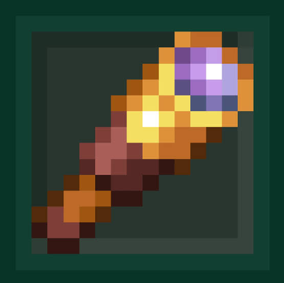
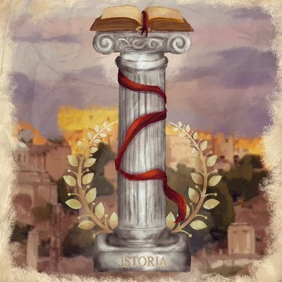

  

<h1 align="center">Spyglass</h1>

  Logging and rollback for Paper 26.1.2, 26.2 and 26.3. 
  See who changed what, search it in seconds, and roll back griefing without lagging the server.

  
  
  
  

  
  
  
  

Spyglass records blocks, containers, items, chat, commands, logins and combat, lets staff search all of it with short queries, and rolls back griefing off the main thread. It runs on ClickHouse (recommended), SQLite, MariaDB/MySQL or MongoDB.

Installing, commands, configuration and the developer API are all in the **[documentation](https://medievalrp-net.github.io/Spyglass/)**.

## Sponsors

Proudly sponsored by and running on:

  
  &nbsp;&nbsp;
  

## Modules

- `spyglass/`: the Paper plugin.
- `spyglass-api/`: the public API other plugins build against, on Maven Central as `net.medievalrp:spyglass-api`. See the [developer docs](https://medievalrp-net.github.io/Spyglass/reference/api/).
- `spyglass-core/`: shared internals, like storage and codecs.
- `spyglass-velocity/`: an optional, read-only Velocity companion for cross-server search.
- `spyglass-importer/`: a command-line CoreProtect importer.

## License

The plugin (`spyglass`, `spyglass-core`, `spyglass-velocity`) is licensed under [GPL-3.0](LICENSE). The API (`spyglass-api`) is [Apache-2.0](spyglass-api/LICENSE), so other plugins can depend on it freely. See [licensing](.github/LICENSING.md) for details; contributions are covered by the [CLA](.github/CLA.md).

The CoreProtect importer is a clean-room implementation, written from paraphrased schema notes rather than CoreProtect's GPL source.
